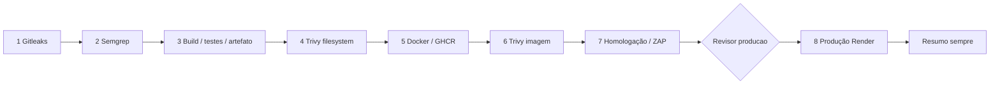

# Casa Digital Segura — Pipeline DevSecOps

[](https://github.com/PedroBalles/CP3-DevSecOps-Challenge/actions/workflows/devsecops.yml)

Plataforma gamificada de conscientização sobre phishing para colaboradores da Leroy Merlin. Implementação da atividade **CP 03 — Pipeline DevSecOps** com GitHub Actions.

> **Estado:** esteira completa e **8/8 etapas com sucesso** na [execução #23](https://github.com/PedroBalles/CP3-DevSecOps-Challenge/actions/runs/41322728115), com **aprovação humana registrada** (PedroBalles, ambiente `producao`) e aplicação no ar em https://cp3-devsecops-challengeatsha256.onrender.com servindo o commit `53d7796`.

## Integrantes

| Nome | RM |
|---|---|
| Cauã Vitack | 566119 |
| Erik Gunnar | 565107 |
| Guilherme Pierre | 562402 |
| Pedro Balles | 564283 |
| Thiago Louzã | 562404 |

## Esteira



| Etapa | Ferramenta / objetivo | Artifact na execução |
|---|---|---|
| 1 | Gitleaks: secrets no histórico, com redação | `relatorio-01-gitleaks` |
| 2 | Semgrep: SAST, rulesets default/OWASP + regras locais | `relatorio-02-semgrep` |
| 3 | npm/TypeScript: dependências, auditoria, build e testes | `relatorio-03-build`, `artefato-aplicacao-<SHA>` |
| 4 | Trivy fs: CVEs, misconfig e secrets; HIGH/CRITICAL bloqueiam | `relatorio-04-trivy-sca` |
| 5 | Docker Buildx: imagem multi-stage não-root e push pelo SHA | `relatorio-05-docker-build` |
| 6 | Trivy image: HIGH/CRITICAL com correção bloqueiam | `relatorio-06-trivy-image` |
| 7 | ZAP baseline: análise informativa do contêiner em homologação | `relatorio-07-homologacao-zap` |
| 8 | Environment `producao`, aprovação e deploy no Render por digest | `relatorio-08-producao` |
| ★ | Consolidação de status e contagens, inclusive em falha | `resumo-da-esteira` |

**Relatórios mais recentes:** abrir o [histórico da esteira](https://github.com/PedroBalles/CP3-DevSecOps-Challenge/actions/workflows/devsecops.yml), escolher a execução e baixar os artifacts acima. A execução completa mais recente é a [#23](https://github.com/PedroBalles/CP3-DevSecOps-Challenge/actions/runs/41322728115) do commit `2057159`.

### Resultados medidos localmente

| Etapa | Resultado observado |
|---|---|
| 1 Gitleaks | 18 commits, 59,74 MB, 11 falsos positivos documentados → 0 após fingerprints corretos |
| 2 Semgrep | 540 regras, 226 arquivos, 0 achados; bloqueio comprovado com fixture `eval` (exit 1 → exit 0) |
| 3 Build | `tsc --noEmit` 0 erros, build ok, 39 testes passando, lint limpo |
| 4 Trivy fs | 5 CRITICAL + 14 HIGH corrigidos por upgrade → 0 (nenhuma supressão) |
| 4b `npm audit` | produção (`--omit=dev`): 0 em todas as severidades; 11 high restantes são só de build/teste |
| 5–8 | Executados no Actions; 8 bloqueada por credencial do Render ausente |

Detalhes, comandos e saídas em [validação local](docs/validacao-local.md).

## Executar localmente

Node.js 22.22.0, npm e Python 3 (para testes auxiliares dos gates).

```bash
npm ci
npm run dev
# http://localhost:3000
```

```bash
npx tsc --noEmit
npm run build
npm run test:ci
# Opcional: testes de navegador existentes.
npx playwright install chromium
npm run test:browser
```

O fluxo original Vinext foi mantido. O contêiner usa Next standalone; configuração e limitações de D1/autenticação estão em [pipeline.md](docs/pipeline.md).

## Executar via Docker

```bash
docker build --build-arg APP_REVISION="$(git rev-parse HEAD)" -t casa-digital:local .
docker run --rm --name casa-digital -p 3000:3000 casa-digital:local
curl -f http://localhost:3000/api/health
```

Não passar credenciais em ARG/ENV versionados ou comandos compartilhados. Porta 3000, usuário `node`, health check e revisão por `/api/health`. Docker não estava disponível no executor desta entrega; o build da imagem ainda precisa ser validado.

## Configuração para concluir a entrega

1. Publicar os arquivos deste pacote no repositório; manter `package-lock.json` versionado.
2. Criar GitHub Environments **`homologacao`** e **`producao`**. Em `producao`, habilitar Required reviewers (mínimo 1), impedir autoaprovação quando possível e restringir à `main` ou `master`. **Sem isso, YAML não garante aprovação humana.**
3. Criar o Web Service no Render (Existing Image, plano Free) e preencher `RENDER_SERVICE_ID`, `DEPLOY_URL` e o secret `RENDER_API_KEY` no Environment `producao`, conforme [docs/pipeline.md](docs/pipeline.md).
4. Permitir publicação de pacotes pelo workflow e manter o pacote GHCR público, para o Render puxar sem credencial.
5. Executar a esteira em `main` ou `master`, corrigir achados reais sem ignorá-los em massa e revisar os artifacts.
6. Demonstrar bloqueio/correção num PR de teste SAST, conforme o procedimento seguro em `docs/pipeline.md`.
7. Registrar aprovador/data, URL de produção e prints genuínos em [docs/evidencias](docs/evidencias/README.md). Preencher nome/RM e garantir contribuições individuais reais.

### Aprovação e produção — registro obrigatório

- Execução completa bem-sucedida: [run #23](https://github.com/PedroBalles/CP3-DevSecOps-Challenge/actions/runs/41322728115) — 8/8 etapas, commit `2057159`. Também 8/8 em #16, #17, #20, #21 e #22.
- Execução bloqueada e correção: demonstrada no Actions em sete ocasiões — Trivy (35 HIGH), Docker (contexto de build), trivy-imagem (58 achados), ZAP (exit 3 e exit 2) e Semgrep (`--strict`). Cada uma foi corrigida na raiz. Registro em [execuções reais](docs/evidencias/execucoes-actions.md).
- Quem aprovou / data: **PedroBalles**, ambiente `producao` (deployment review da run #23).
- URL de produção: https://cp3-devsecops-challengeatsha256.onrender.com
- Imagem publicada / digest: publicada no GHCR a cada execução; o digest exato de cada run está em `relatorio-05-docker-build`.
- Resumo da Esteira: publicado como artifact `resumo-da-esteira` e na aba Summary de cada execução.

## Documentação

- [Oito etapas e configuração Render](docs/pipeline.md)
- [Achados, decisões e lições aprendidas](docs/observacoes.md)
- [Validação local e impedimentos](docs/validacao-local.md)
- [Checklist de evidências](docs/evidencias/README.md) e [relatórios locais reais](docs/evidencias/relatorios-locais/LEIA-ME.md)
- [Roteiro de apresentação de até 10 minutos](docs/roteiro-apresentacao.md)

## Segurança e rastreabilidade

Gitleaks varre histórico completo e mascara valores. Semgrep usa `--error`. Trivy não recebe ignorelist. ZAP é informativo por exigência do PDF; erro operacional não é aprovação. Docker/produção usam o digest retornado do push, não tag mutável. Relatórios são publicados com `always()` e ausência não significa zero. O scan da imagem inclui componentes do sistema operacional ausentes no lockfile.

O helper de headers `X-ChatGPT-*` é resquício do template original, **não** autenticação para aplicação pública. A CSP contém `unsafe-inline` por compatibilidade e precisa evoluir para nonce/hash; isso foi registrado como risco residual, não como problema completamente resolvido.

