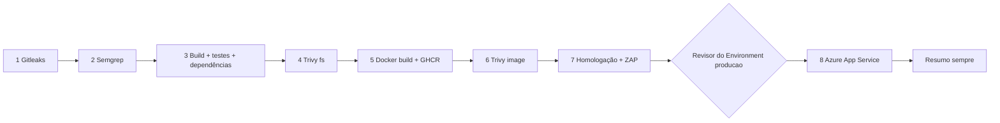

# CP 03 — Esteira DevSecOps

## Escopo e rastreabilidade

Aplicação: **Casa Digital Segura**, plataforma gamificada de conscientização sobre phishing.
Fonte: https://github.com/TiagoLouzaPetagna/Challenge-Leroy
Base analisada: `82a7d12293ced7c32dc90e119f2093d0ccb07b18`.
Requisitos: PDF “CP 03 - Pipeline DevSecOps”, páginas 3–13.

Esta entrega implementa a configuração local. **Não representa uma execução concluída do Actions, publicação de imagem ou deploy.** Os registros reais devem ser incluídos após configurar GitHub e Azure.

## Fluxo

O job `resumo` depende das oito etapas e usa `always()`. Coleta status reais de `needs`, baixa artifacts existentes e calcula contagens em Python (equivalente ao jq sugerido no enunciado). Relatório ausente aparece como indisponível, nunca como zero.

| Nº | Job / ferramenta | Gate | Artifact |
|---|---|---|---|
| 1 | `secrets-scan` / Gitleaks 8.30.1 | Qualquer segredo bloqueia; histórico completo e `--redact` | `relatorio-01-gitleaks` |
| 2 | `sast` / Semgrep 1.183.0 | `--error --strict`; `p/default`, `p/owasp-top-ten` e regras locais adicionais | `relatorio-02-semgrep` |
| 3 | `build` / Node 22.22.0, npm, TypeScript | Tipos, build ou testes com erro bloqueiam; npm audit informativo | `relatorio-03-build` e `artefato-aplicacao-<SHA>` |
| 4 | `sca` / Trivy 0.76.1 | `vuln,misconfig,secret`, HIGH/CRITICAL bloqueiam | `relatorio-04-trivy-sca` |
| 5 | `docker-build` / Buildx + GHCR | Build ou push com erro bloqueiam | `relatorio-05-docker-build` |
| 6 | `image-scan` / Trivy image | HIGH/CRITICAL **com correção disponível** bloqueiam (`--ignore-unfixed`) | `relatorio-06-trivy-image` |
| 7 | `dast-staging` / ZAP 2.17.0 | Alertas informativos; erros operacionais/JSON ausente bloqueiam | `relatorio-07-homologacao-zap` |
| 8 | `deploy-prod` / Environment + Azure OIDC | Revisor obrigatório; falha de deploy, saúde ou revisão servida bloqueia | `relatorio-08-producao` |
| ★ | `resumo` / Python | Executa mesmo quando etapas anteriores falham | `resumo-da-esteira` |

### Triggers e permissões

- Push/PR em `main` e `master`, além de execução manual. A branch padrão encontrada no repositório é `master` (base analisada); os dois nomes são suportados.
- PR executa etapas 1–4, sem publicar imagem nem acessar a nuvem. A execução completa ocorre em `main`.
- `contents: read` no topo; `packages: write` **somente** no job 5; `packages: read` no scan e homologação; `id-token: write` apenas no deploy.
- Checkout sem persistir credenciais; actions fixadas por SHA consultado no GitHub.
- Ferramentas fixadas por versão; Gitleaks/Trivy têm checksum verificado. Rulesets remotos do Semgrep e bancos CVE são atualizáveis: resultados podem mudar sem alteração do código. Para rastreabilidade, guardar todos os artifacts.
- Uploads dos relatórios usam `if: always()`. Se a ferramenta nem iniciar, pode não haver relatório: o upload acusa ausência e o resumo não inventa resultado.
- Docker publica tag SHA e registra digest/manifesto. Produção e homologação usam **o mesmo digest**, nunca `latest`.

## Adaptação à stack

O projeto original usa Vinext/Vite para desenvolvimento e build. Mantido `npm run build` para verificar esse caminho e os testes de HTML existentes. O contêiner usa `next build --webpack` com `output: standalone`, compatível com os componentes React e rotas App Router, evitando executar um servidor de desenvolvimento em produção. Dependências de desenvolvimento não são copiadas integralmente para o runtime; apenas tracing standalone, assets e arquivos públicos.

A configuração opcional Cloudflare D1 do projeto original não é usada pela interface atual; o deploy Azure não fornece D1. Se alguma funcionalidade passar a depender de `getDb()`, adaptar o backend antes de promover. Os headers `X-ChatGPT-*` do template **não constituem autenticação confiável na Internet**; não habilitar autorização baseada neles fora do gateway original.

O Dockerfile é multi-stage, imagem slim, usuário `node`, porta 3000 e health check `/api/health`. `APP_REVISION` contém somente o SHA público, não credenciais. A rota de saúde informa a revisão; o deploy compara-a ao SHA esperado para não confundir uma versão antiga saudável com a entrega nova.

## SCA versus imagem

O scan de filesystem identifica dependências pelo `package-lock.json`, inclusive dev, além de Dockerfile/configurações e possíveis secrets. O scan da imagem observa as dependências realmente empacotadas e também pacotes Debian/OpenSSL/Node da base. Uma CVE pode aparecer só em um desses scans. Não remover dependências dev da avaliação apenas para reduzir achados; corrigir e registrar a árvore antes/depois.

## Cabeçalhos e limitações

`next.config.ts` desabilita X-Powered-By e inclui CSP, nosniff, frame denial, política de referência e permissões. A CSP ainda permite inline scripts/styles para compatibilidade com hidratação Next e estilo existente: **risco residual**, não CSP estrita. A evolução recomendada é CSP com nonce/hash por resposta e teste de hidratação. HSTS só produz efeito por HTTPS. ZAP baseline é passivo e não substitui revisão de autenticação, autorização ou lógica de negócio.

## Fail-closed: detalhes que decidem se o gate realmente barra

Três pontos foram corrigidos após execução real, e todos mudavam o veredito da esteira:

- **`pipefail` obrigatório nos steps com `| tee`.** Sem ele o status devolvido é o do `tee`, então `npx tsc --noEmit` quebrado publica relatório e etapa verde. Aplicado em `npm ci` e na etapa de tipos/build/testes.
- **Fingerprint do `.gitleaksignore` precisa conter o segredo real.** O relatório gerado com `--redact` grava `***` no fingerprint, que nunca casa na comparação. Os fingerprints foram regravados a partir do relatório completo; a verificação é rodar com e sem a supressão e comparar `leaks found`.
- **Relatório ausente não é zero.** `security-gate.py` retorna 2 (erro) para Trivy/ZAP sem alvos, e o Resumo escreve "não disponível", nunca 0.

## Homologação e aprovação

`homologacao` executa a imagem publicada em contêiner efêmero no runner. ZAP acessa somente `127.0.0.1:3000`, sem varrer serviços de terceiros. Um scan sem High não significa aplicação segura; revisor deve avaliar também Medium e falhas não cobertas por baseline.

A aprovação é controlada por **Settings → Environments → producao → Required reviewers**; YAML sozinho não impõe um revisor. Configurar ao menos uma pessoa, impedir autoaprovação quando disponível e restringir branches a `main`. Conferir se o plano do GitHub permite essa proteção em repositório público. O responsável da execução (`github.actor`) não é necessariamente o aprovador; o relatório aponta para o deployment review, que é a fonte do nome/data reais.

## Deploy real: Azure App Service Linux (contêiner)

Pré-requisitos: assinatura Azure, resource group, App Service Plan Linux e Web App compatível com contêineres. Recursos têm custo; criação não foi executada nesta entrega.

1. Criar Environments `homologacao` e `producao` no repositório.
2. Configurar revisores de `producao`, limitar a `main` e verificar a proteção antes do primeiro deploy.
3. Criar aplicação/identidade no Microsoft Entra ID e credencial federada OIDC com subject `repo:<owner>/<repo>:environment:producao`, issuer `https://token.actions.githubusercontent.com`, audience `api://AzureADTokenExchange`.
4. Conceder à identidade somente permissão necessária de configuração/restart no Web App alvo (por exemplo Website Contributor, escopo no recurso, não Owner da assinatura).
5. Criar variables no Environment `producao`:

| Variável | Valor esperado |
|---|---|
| `AZURE_CLIENT_ID` | Client ID da identidade federada |
| `AZURE_TENANT_ID` | Tenant ID |
| `AZURE_SUBSCRIPTION_ID` | Assinatura |
| `AZURE_RESOURCE_GROUP` | Resource group existente |
| `AZURE_WEBAPP_NAME` | Web App Linux existente |
| `DEPLOY_URL` | URL HTTPS pública do **Web App do grupo**, sem caminho/query |

Esses IDs são identificadores, não segredos. OIDC dispensa client secret. Se outro provedor exigir credenciais, armazená-las em **Environment secrets** e nunca em código.

6. Após o primeiro push, tornar o pacote GHCR público (Packages → Package settings → Change visibility). O Azure precisa conseguir puxar a imagem; o workflow deliberadamente não distribui PATs. Se a política exigir pacote privado, configurar credencial de leitura no Web App por canal seguro, antes de usar esse modelo.
7. Habilitar HTTPS-only no Web App. O workflow configura `WEBSITES_PORT=3000`, implanta `imagem@digest`, reinicia e verifica `/api/health` e o SHA.
8. Revisor baixa relatórios 1–7 e registra a decisão. Só então aprova o job 8.
9. Em falha após deploy, inspecionar logs do App Service. Rollback: reimplantar o digest anteriormente aprovado; não há rollback automático nesta versão.

## Demonstração de bloqueio sem contaminar main

Não introduzir segredo fictício em commit: Gitleaks varre `--all`, e o segredo permaneceria no histórico.

1. Criar branch `teste/quality-gate-sast` a partir da versão final.
2. Adicionar arquivo temporário `lib/gate-demo.ts` com `export const demonstracao = () => eval("1 + 1");` (fixture deliberadamente insegura, sem entrada externa).
3. Abrir PR para `main`; etapa 2 deve falhar com regra local `javascript-no-eval`.
4. Guardar URL da execução e screenshot. Remover o arquivo em novo commit nessa branch; execução seguinte deve passar pelo SAST.
5. Não fazer merge do commit inseguro. Guardar evidências de antes/depois em `docs/evidencias/`.

**Estado:** procedimento fornecido; nenhuma execução GitHub bloqueada/corrigida foi simulada.
